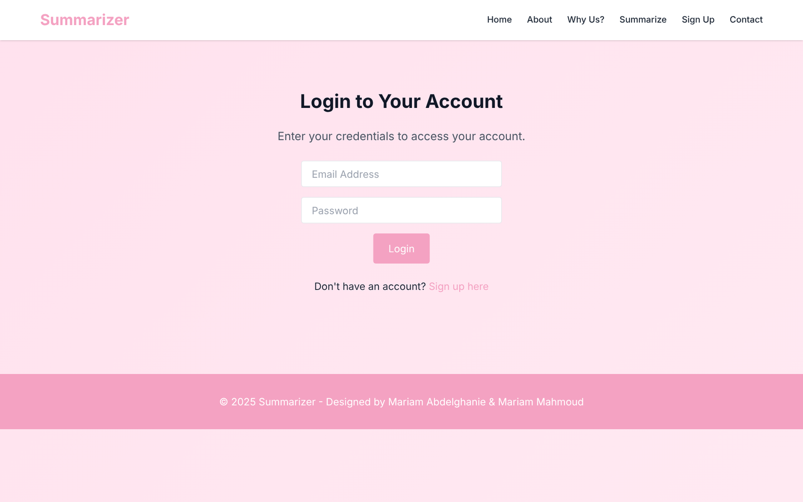
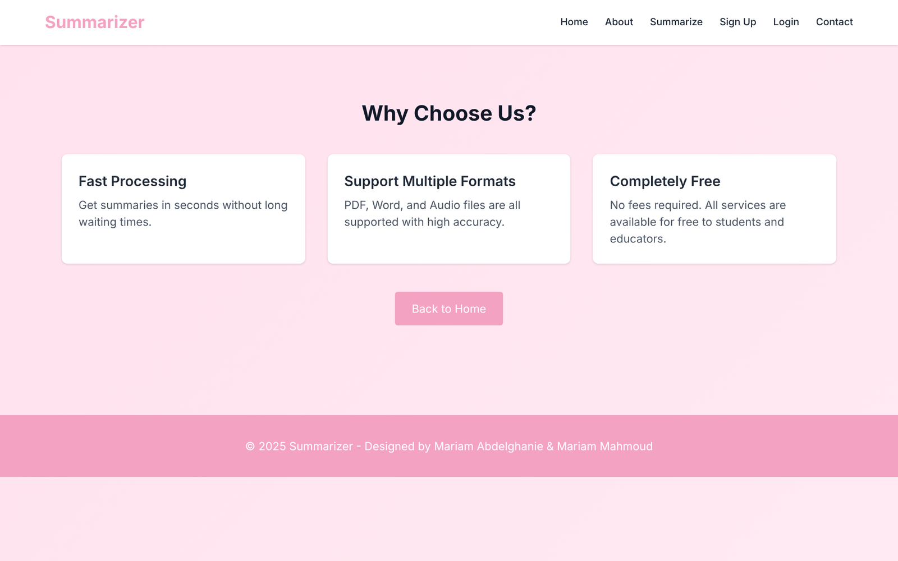

# Samuraizer — Document Summarizer

A web app that turns long documents into short summaries. Upload a PDF or Word file and get the key sentences back in seconds.


## Screenshots


| Login | Why us |
|---|---|
|  |  |

## Features

- **PDF and DOCX support**: text is extracted with `PyPDF2` and `python-docx`
- **Extractive summarization**: sentences are ranked by word frequency and the top ones are returned in a single summary
- **Language-agnostic scoring**: no stopword filtering, so it works on English and Turkish text alike
- **Multi-page frontend**: landing, about, why-us, contact, login, register and summarize pages, built with Tailwind CSS

## How it works

```
Upload file ──► extract text (PyPDF2 / python-docx)
            ──► split into sentences (NLTK punkt)
            ──► score each sentence by word frequency (FreqDist)
            ──► return the top N sentences (heapq.nlargest)
```

## Run the summarizer

```bash
pip install PyPDF2 python-docx nltk
python summarize_file.py path/to/document.pdf
```

The summary is printed to stdout, so the script can be called from any backend.

## Project structure

| File | Purpose |
|---|---|
| `index.html` | Landing page |
| `summarize.html` | Upload page |
| `login.html`, `register.html` | Account pages |
| `about.html`, `why-us.html`, `contact.html` | Info pages |
| `summarize_file.py` | Text extraction and summarization engine |

## Roadmap

- [ ] Add the PHP backend (`php/upload.php`, `login.php`, `register.php`) that the forms post to
- [ ] Audio (MP3) summarization with speech-to-text
- [ ] Abstractive summaries with a transformer model

---

Made by [Mariam Mahmoud](https://github.com/mar7233)
